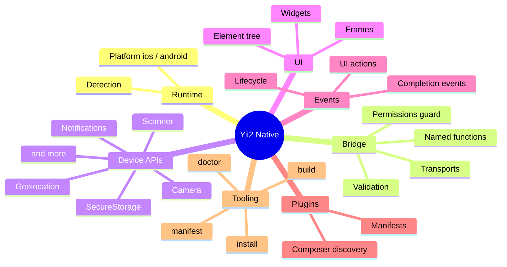

# Yii2 Native documentation

Yii2 Native is the Yii2 side of a native mobile app architecture inspired by
[NativePHP Mobile](https://nativephp.com/docs/mobile): your Yii2 application
runs inside a native iOS / Android shell, describes its UI as a native element
tree, and talks to device APIs through a named-function bridge.

> **Scope.** This package is the PHP half: component, bridge, device APIs, UI
> widgets, events, plugins, build manifest and tooling. The Swift / Kotlin shells
> and the embedded PHP runtime are **not** bundled yet (see
> [`native/README.md`](../native/README.md)). Everything here is designed and
> tested against the protocol in [`native/protocol.json`](../native/protocol.json),
> and works without a device by using the [fake transport](testing.md).

## Where to start

| I want to... | Read |
|---|---|
| Install it and make my first native call | [Getting started](getting-started.md) |
| Understand how the pieces fit | [Architecture](architecture.md) |
| Configure the component | [Configuration](configuration.md) |
| Call the camera, scanner, storage, ... | [Device APIs](device-apis.md) |
| Handle results, lifecycle, UI actions | [Events](events.md) |
| Build screens in PHP | [UI widgets](ui-widgets.md) |
| Use it from JavaScript | [JavaScript client](javascript.md) |
| Extend it | [Plugins](plugins.md) |
| Declare permissions, generate manifests | [Permissions & manifest](permissions-and-manifest.md) |
| Use the `native/*` console commands | [Console commands](console-commands.md) |
| Lock down the HTTP bridge | [Security](security.md) |
| Write tests without a device | [Testing](testing.md) |
| Look up a function, event or node | [Protocol reference](reference/protocol.md) |
| Understand how the wire format works | [Bridge](bridge.md) |
| Move from the foundation release | [Upgrading](upgrading.md) |

## Feature map

