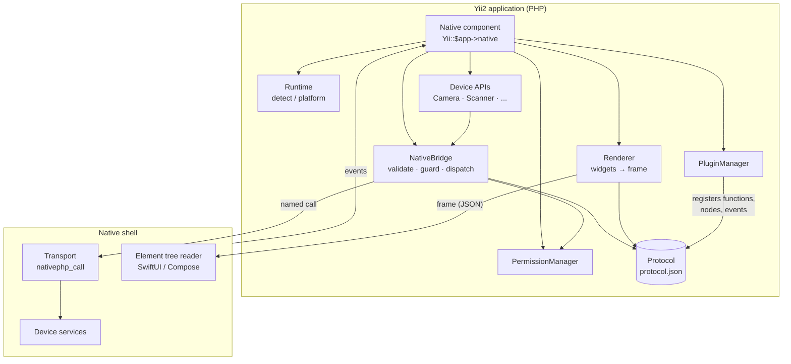
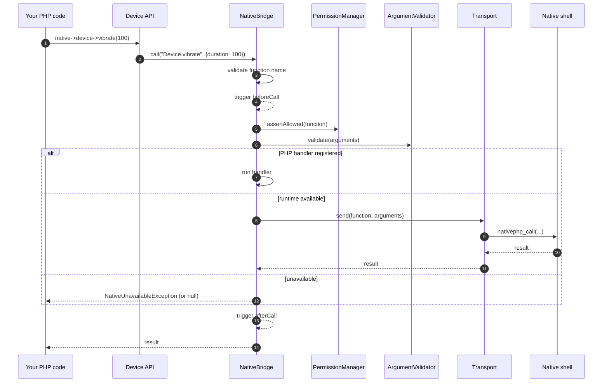
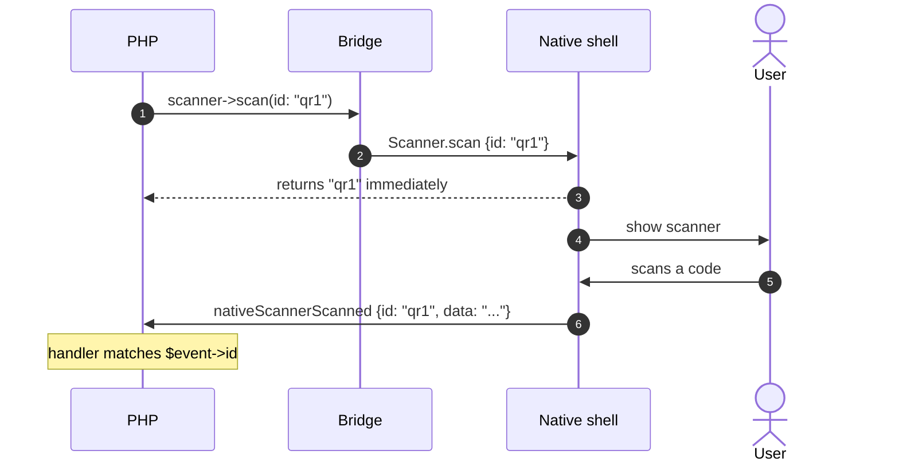
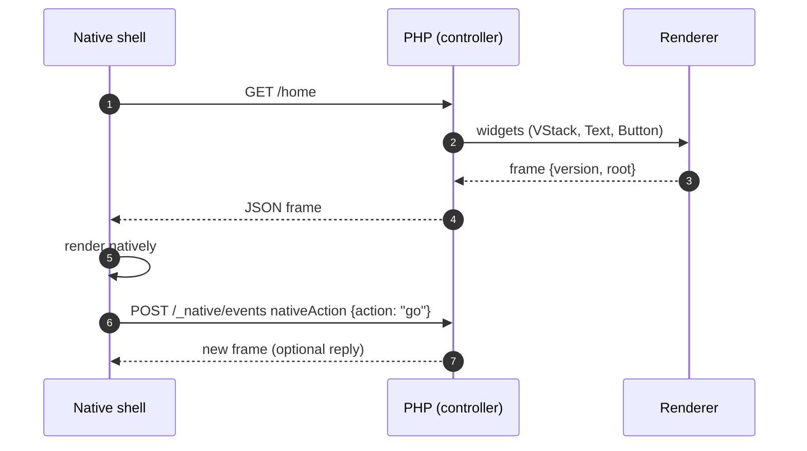

# Architecture

Yii2 Native keeps **native UI rendering** separate from **device / API calls**,
following the same high-level split as NativePHP Mobile:

- the **renderer** turns a widget tree into a compact *frame*; the shell draws it natively;
- the **bridge** is a named-function channel (`Camera.getPhoto`, `SecureStorage.get`, ...)
  for device capabilities, extensible through plugins.

## Components

## What lives where

| Layer | Namespace | Responsibility |
|---|---|---|
| Component | `greenmeteor\native\Native` | Entry point, configuration, event dispatch, APIs |
| Runtime | `...\runtime` | Am I inside the native shell? Which platform? |
| Bridge | `...\bridge` | Named calls, transports, handlers, validation, events |
| Device APIs | `...\api` | Typed methods over bridge functions |
| Protocol | `...\protocol` | Reads `native/protocol.json`, validates arguments |
| Renderer / widgets | `...\renderer`, `...\widgets` | Element tree and frames |
| Events | `...\events` | Native events and bridge-call events |
| Plugins | `...\plugin` | Manifests, discovery, lifecycle |
| Permissions | `...\permission` | Declared permissions → platform manifests |
| Web | `...\web` | HTTP bridge endpoints, response format |
| Tooling | `...\build`, `...\commands` | Manifest, doctor, installer, scaffolder, CLI |

## A device call

## An interactive call and its event

Calls that need the user (camera, scanner, dialogs, ...) cannot return a result
synchronously. They return a **request id** and the result comes back as an
event with the same id. See [Events](events.md).

## A screen

## Persistent runtime

The runtime is designed to keep PHP resident between requests inside the shell
(`Runtime::$persistent` defaults to `true`). The shells are not bundled yet, but
write your code as if that holds:

- Don't keep per-user state in static properties.
- Register event handlers once, at bootstrap (component config or a bootstrap
  class), not inside actions, so they are not added repeatedly.

## Design decisions

- **Contract first.** `native/protocol.json` is the single source of truth for
  functions, events and node types. Tests ensure the PHP APIs, widgets and
  `NativeEvents` match it, and the [reference](reference/protocol.md) is generated
  from it.
- **Validate at the bridge.** Argument validation and permission checks live in
  `NativeBridge`, so PHP callers, the HTTP endpoint and plugins are all covered.
- **Fail early and loudly** for malformed trees and arguments; stay silent only
  where you opt in (`allowUnavailable`).
