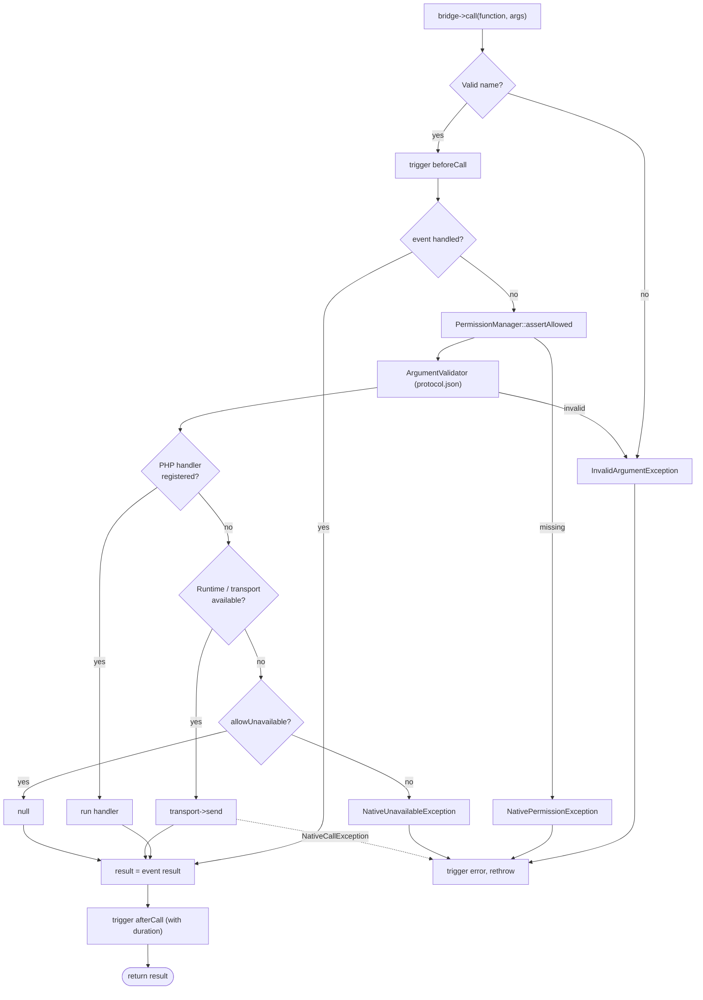

# The bridge

The bridge is a named-function channel between PHP and the native shell.
Everything in [Device APIs](device-apis.md) is a typed wrapper over it, and you
can call it directly:

```php
$result = Yii::$app->native->bridge->call('Device.vibrate', ['duration' => 100]);
// shorthand:
$result = Yii::$app->native->call('Device.vibrate', ['duration' => 100]);
```

Function names look like `Namespace.method` (`[A-Za-z_][A-Za-z0-9_]*` segments
separated by dots, max 128 characters). Anything else throws
`yii\base\InvalidArgumentException` before reaching the shell.

## Call pipeline



## Bridge events

| Event | When | Useful properties of `NativeCallEvent` |
|---|---|---|
| `NativeBridge::EVENT_BEFORE_CALL` (`beforeCall`) | before everything except name validation | `function`, `arguments`; set `handled = true` and `result` to short-circuit |
| `NativeBridge::EVENT_AFTER_CALL` (`afterCall`) | after a successful call | `result`, `duration` (ms) |
| `NativeBridge::EVENT_ERROR` (`error`) | any exception, which is then re-thrown | `error`, `duration` |

```php
Yii::$app->native->bridge->on(NativeBridge::EVENT_AFTER_CALL, function (NativeCallEvent $e) {
    Yii::info("{$e->function} took {$e->duration} ms", 'native');
});
```

The bridge itself only logs the function name and timing (at debug level),
**never arguments**, because they can contain secrets (e.g. `SecureStorage.set`).

## Transports

A transport carries a call to the native side.

```php
interface BridgeTransportInterface
{
    public function isAvailable(): bool;
    public function send(string $function, array $arguments): mixed;
}
```

| Transport | Use |
|---|---|
| `FunctionTransport` (default) | Calls the global function the shell injects (`nativephp_call`). |
| `FakeTransport` | In-memory, for tests and development. See [Testing](testing.md). |

`FunctionTransport` options:

| Option | Default | Meaning |
|---|---|---|
| `functionName` | `nativephp_call` | Global function to call |
| `jsonArguments` | `false` | Pass `json_encode($arguments)` instead of the array |
| `jsonResponse` | `false` | `json_decode` string responses |

A response consisting solely of an `error` object, for example
`{"error": {"type": "denied", "message": "User said no", "code": 7}}`, is turned
into a `NativeCallException` with `errorType`, `function`, message and code.
Custom transports can simply throw `NativeException` subclasses.

```php
'bridgeClass' => [
    'class' => NativeBridge::class,
    'transport' => ['class' => FunctionTransport::class, 'jsonArguments' => true, 'jsonResponse' => true],
],
```

## PHP-side handlers

Register a PHP implementation of a function, typically from a
[plugin](plugins.md). It runs instead of the transport and works even when the
native runtime is absent:

```php
Yii::$app->native->bridge->register('Reports.summary', function (array $args, string $function) {
    return ['rows' => Report::find()->where(['year' => $args['year']])->count()];
});
```

## Argument validation

For every function declared in `protocol.json` with a `params` spec, the bridge
checks the arguments **before** the call reaches a handler or the shell:

| Check | Example error |
|---|---|
| unknown parameter | `Device.vibrate: unknown parameter 'evil'.` |
| missing required parameter | `Browser.open: missing required parameter 'url'.` |
| type (`string`, `integer`, `number`, `boolean`, `array` = list, `object` = map) | `Device.vibrate: parameter 'duration' must be of type integer, string given.` |
| `enum` | `Haptics.impact: parameter 'style' must be one of: light, medium, ...` |
| `format: http-url` | only absolute `http(s)` URLs |
| `format: path` | non-empty, no NUL bytes |
| size | strings over 1 MB are rejected |

Violations throw `yii\base\InvalidArgumentException`. This is what protects the
[HTTP bridge](security.md): a page calling `Native.browser.open({url: 'javascript:...'})`
is rejected exactly like PHP code would be.

- Functions **without** a `params` spec (typical for plugin functions that don't
  declare one) are not validated. Declare `params` in your plugin manifest to opt in.
- Disable globally with `'validateArguments' => false` (not recommended).

## Permissions guard

If a function's spec lists `permissions` that you have not declared in the
`permissions` option, the call fails with `NativePermissionException`
(`->missing` lists them) instead of failing obscurely on the device. See
[Permissions & manifest](permissions-and-manifest.md).

## Errors at a glance

| Exception | Meaning |
|---|---|
| `yii\base\InvalidArgumentException` | bad function name or arguments |
| `NativePermissionException` | permission not declared |
| `NativeUnavailableException` | no native runtime attached |
| `NativeCallException` | the native side reported an error |
| `NativeException` | base class of the above (except `InvalidArgumentException`) |
