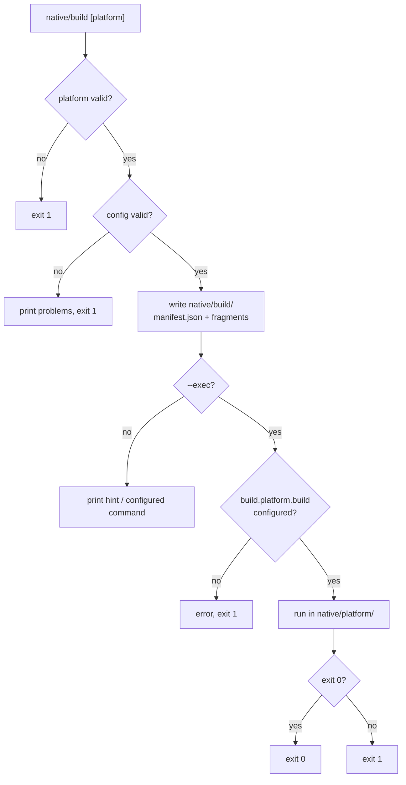

# Console commands

The bootstrap registers a `native` module in console applications:

| Command | Purpose |
|---|---|
| `php yii native/install [--force]` | Create the project layout and `config/native.php` |
| `php yii native/doctor` | Check environment and configuration (exit 1 on failure) |
| `php yii native/config` | Print the effective configuration and validation problems |
| `php yii native/manifest [--write]` | Print or write the build manifest |
| `php yii native/build [platform] [--exec]` | Validate, write the manifest, optionally run the shell build |
| `php yii native/run [platform] [--exec]` | Same, using the `run` command |
| `php yii native/plugin/list` | List registered plugins |
| `php yii native/plugin/discover` | List plugins found in the project and in Composer packages |
| `php yii native/plugin/info <id>` | Show a registered plugin's manifest |
| `php yii native/plugin/make <id>` | Scaffold a plugin in `native/plugins/` |

`platform` is `ios`, `android` or `all` (default). Anything else exits with `1`.
Run `php yii help native/<command>` for options.

## `native/doctor` checks

| Check | Fails when |
|---|---|
| PHP | older than 8.2 |
| Protocol | `protocol.json` is missing or invalid |
| Configuration | `Native::validate()` reports problems |
| Plugins | a plugin failed to load or boot |
| HTTP bridge | enabled with **no secret and `requireRuntime` off** (warns when only the secret is missing) |
| Preview | enabled while `YII_ENV_PROD` is true (warns when enabled elsewhere) |

Other checks (extensions, project directory, platform shells, runtime) report
`ok` or `warn`. Use it in CI: `php yii native/doctor`.

## Build flow

This package does **not** bundle the Xcode / Gradle projects. `native/build`
prepares everything the shell needs and, only if you ask, runs *your* command.



Configure the commands per platform:

```php
'native' => [
    'class' => Native::class,
    'build' => [
        'android' => ['build' => './gradlew assembleRelease', 'run' => './gradlew installDebug'],
        'ios'     => ['build' => 'xcodebuild -scheme App -configuration Release build'],
    ],
],
```

Commands run with their working directory set to `native/<platform>/`, are
streamed to your terminal, and are never executed without `--exec`. They come
from your own configuration; treat that file as trusted code.

## CI example

```yaml
- run: php yii native/config     # validates the configuration
- run: php yii native/doctor
- run: php yii native/manifest --write
```
