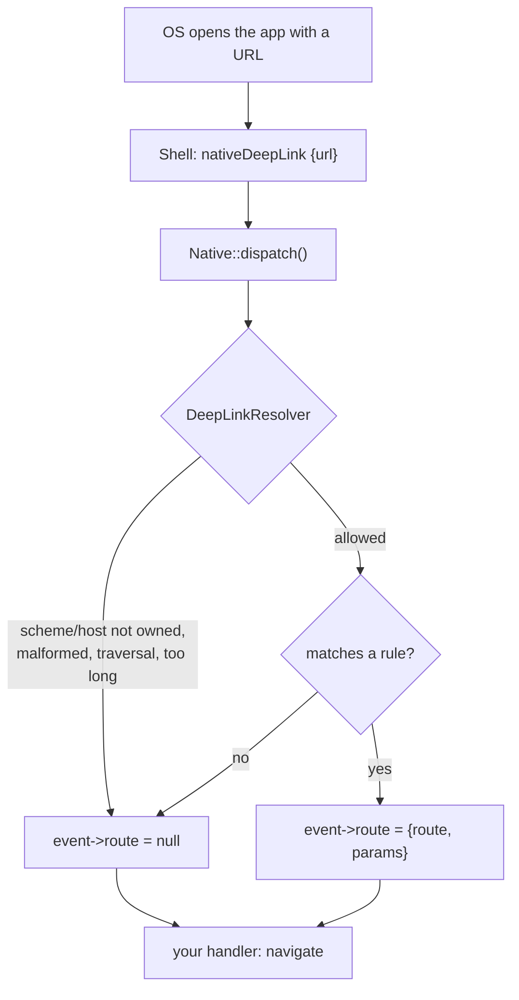

# Deep links

Deep links open your app on a specific screen from a URL such as
`acme://orders/42` or `https://shop.acme.test/orders/42`.

The shell receives the URL from the OS and reports it as a `nativeDeepLink`
event. Yii2 Native resolves it to a **Yii route** for you, after checking that the
URL is one your app actually owns.



## Configure

```php
'native' => [
    'class' => Native::class,
    'appId' => 'com.acme.shop',
    'deepLinkScheme' => 'acme',                    // custom scheme: acme://...
    'deepLinkHosts' => ['shop.acme.test'],         // universal / app links: https://shop.acme.test/...
    'deepLinks' => [
        'orders/<id:\d+>'  => 'orders/view',       // acme://orders/42
        'promo/<code>'     => 'promo/open',        // default segment pattern: [^/]+
        'u/<user>/posts/<post:\d+>' => 'posts/view',
        ''                 => 'site/index',        // https://shop.acme.test/
    ],
],
```

`deepLinkScheme` and `deepLinkHosts` also feed the [build manifest](permissions-and-manifest.md),
so the shell registers the same scheme and hosts.

## Handle it

```php
Yii::$app->native->on(NativeEvents::DEEP_LINK, function (NativeEvent $e) {
    if ($e->route === null) {
        return;                                   // not ours / no matching rule
    }
    // Decide where to go. Re-use your normal screen actions: e.g. remember the target so the
    // next screen request (or a returned frame) opens it.
    Yii::$app->session->set('nativeTarget', $e->route);
});
```

or resolve one yourself:

```php
$target = Yii::$app->native->resolveDeepLink('acme://orders/42');
// ['route' => 'orders/view', 'params' => ['id' => '42']]   or null
```

## Rules

- Patterns are matched against the whole path (`\z`-anchored). `<name>` matches
  one segment; `<name:regex>` uses your regex. Literal text is escaped, so a `.`
  in a pattern is a dot.
- Captured values are URL-decoded; **query parameters are merged into `params`**,
  and values captured from the path win over a query parameter with the same name.
- The first matching rule wins.

## What is rejected

`resolve()` returns `null` (and `$event->route` stays `null`) for:

| Input | Why |
|---|---|
| any scheme other than your `deepLinkScheme`, `http`, `https` | not yours |
| `http(s)` hosts not in `deepLinkHosts` (including look-alikes like `shop.acme.test.evil.test`) | not yours |
| a custom scheme when `deepLinkScheme` is not set | nothing to match |
| whitespace or control characters, including a trailing newline | malformed |
| `..`, `.` or empty (`//`) path segments | traversal-style |
| URLs over 2048 characters | resource abuse |
| paths matching no rule | no destination |

Treat the **params** as untrusted user input regardless: an `id` that matched
`\d+` is still a value an attacker chose. Authorise access in the target action as
you would for a normal request.
