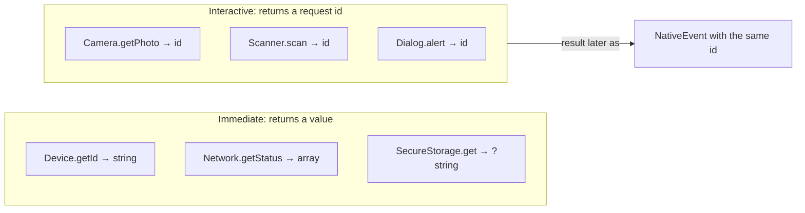

# Device APIs

Typed wrappers over the [bridge](bridge.md), available as properties of
`Yii::$app->native`. Full parameter tables live in the
[protocol reference](reference/protocol.md).

| Property | Class | Highlights |
|---|---|---|
| `camera` | `Camera` | `getPhoto`, `pickImages`, `recordVideo` |
| `scanner` | `Scanner` | `scan` (QR / barcodes), `cancel` |
| `biometrics` | `Biometrics` | `isAvailable`, `prompt` |
| `geolocation` | `Geolocation` | `getCurrentPosition`, `checkPermissions`, `requestPermissions` |
| `microphone` | `Microphone` | `start`, `stop`, `pause`, `resume`, `getStatus` |
| `notifications` | `Notifications` | `schedule`, `cancel`, `enrollPush`, `getPushToken`, `setBadge` |
| `secureStorage` | `SecureStorage` | `set`, `get`, `delete` |
| `device` | `Device` | `getId`, `getInfo`, `getBattery`, `vibrate`, `toggleFlashlight` |
| `haptics` | `Haptics` | `impact`, `notification`, `selection` |
| `dialog` | `Dialog` | `alert`, `toast` |
| `share` | `Share` | `text`, `url`, `file` |
| `browser` | `Browser` | `open`, `openInApp`, `authenticate` |
| `clipboard` | `Clipboard` | `copy`, `paste`, `clear` |
| `filesystem` | `Filesystem` | `getPaths`, `pickFiles`, `saveToPhotos` |
| `network` | `Network` | `getStatus`, `isConnected` |
| `system` | `System` | `getPlatform`, `isIos`, `isAndroid`, `isMobile`, `openAppSettings`, `getLocale`, `getAppInfo` |

## Immediate vs. interactive



**Interactive** methods need the user (or take time), so they return a `string`
request id immediately. Pass your own id to correlate, or let one be generated:

```php
$id = Yii::$app->native->camera->getPhoto();             // generated id
$id = Yii::$app->native->camera->getPhoto('avatar');     // your own id
```

The result is delivered as a [native event](events.md) carrying that `id`:

| Method | Completion event |
|---|---|
| `camera->getPhoto()` | `NativeEvents::CAMERA_PHOTO_TAKEN` |
| `camera->pickImages()` | `NativeEvents::MEDIA_PICKED` |
| `camera->recordVideo()` | `NativeEvents::CAMERA_VIDEO_RECORDED` |
| `scanner->scan()` | `NativeEvents::SCANNER_SCANNED` |
| `biometrics->prompt()` | `NativeEvents::BIOMETRIC_COMPLETED` |
| `geolocation->getCurrentPosition()` | `NativeEvents::LOCATION_RECEIVED` |
| `geolocation->requestPermissions()` | `NativeEvents::LOCATION_PERMISSION_RESULT` |
| `microphone->start()` | `NativeEvents::MICROPHONE_RECORDED` (when recording ends) |
| `notifications->enrollPush()` | `NativeEvents::PUSH_TOKEN_RECEIVED` |
| `dialog->alert()` | `NativeEvents::DIALOG_BUTTON_PRESSED` |
| `filesystem->pickFiles()` | `NativeEvents::FILES_PICKED` |
| `browser->authenticate()` | `NativeEvents::BROWSER_AUTH_COMPLETED` |

## Recipes

### Take a photo and use it

```php
// 1. user taps a button
Yii::$app->native->camera->getPhoto('avatar');

// 2. later, in a handler registered at bootstrap
Yii::$app->native->on(NativeEvents::CAMERA_PHOTO_TAKEN, function (NativeEvent $e) {
    if ($e->id !== 'avatar' || $e->get('cancelled')) {
        return;
    }
    Yii::$app->user->identity->setAvatarFromFile($e->get('path'));
});
```

Needs the `camera` permission.

### Scan a QR code

```php
Yii::$app->native->scanner->scan(['qr', 'ean13'], 'Scan the product', 'product-scan');
```

### Biometric gate

```php
if (Yii::$app->native->biometrics->isAvailable()) {
    Yii::$app->native->biometrics->prompt('Confirm payment', 'pay-1');
}
// handler: NativeEvents::BIOMETRIC_COMPLETED → $e->get('success')
```

### Keep a token in the Keychain / Keystore

```php
$store = Yii::$app->native->secureStorage;
$store->set('api_token', $token);
$token = $store->get('api_token');   // ?string
$store->delete('api_token');
```

### Local notification in an hour

```php
Yii::$app->native->notifications->schedule('reminder-1', 'Stand up', 'Time to stretch', time() + 3600);
```

### Share a link and give feedback

```php
Yii::$app->native->share->url('https://example.com/post/42', 'Great read');
Yii::$app->native->haptics->notification('success');
Yii::$app->native->dialog->toast('Shared!');
```

### Branch on platform

```php
$n = Yii::$app->native;
if ($n->system->isIos()) { /* ... */ } elseif ($n->system->isAndroid()) { /* ... */ }
```

`isIos()`, `isAndroid()`, `isMobile()` and `getPlatform()` are answered locally
from the runtime (`NATIVE_PLATFORM` environment variable or the `platform`
option). They never call the shell.

## Validation and errors

Each method validates what it can before calling the bridge (URL schemes, enums,
ranges, non-empty ids); the bridge then validates against `protocol.json`.
Invalid input throws `yii\base\InvalidArgumentException` and never reaches the
shell. Selected rules:

| API | Rule |
|---|---|
| `Browser`, `Share` | only absolute `http(s)` URLs |
| `Device::vibrate` | 1 to 10000 ms |
| `Haptics` | `impact`: light/medium/heavy/rigid/soft; `notification`: success/warning/error |
| `Dialog::alert` | 1 to 3 buttons |
| `Dialog::toast` | `short` or `long` |
| `Scanner::scan` | at least one format from `Scanner::FORMATS` |
| `SecureStorage` | key 1 to 256 characters |
| `Notifications::setBadge` | not negative |

Return values are normalised: `array` methods return `[]` when the shell returns
nothing, optional strings return `null`, flags return `bool`.

## Replacing or extending an API

```php
'native' => [
    'class' => Native::class,
    'apis' => ['camera' => \app\native\AuditedCamera::class],   // extends greenmeteor\native\api\Camera
],
```

Custom APIs for your own plugin functions can extend `BaseApi` (implement
`apiName()` and use `$this->invoke('method', $args)`), or simply call
`$native->call('MyPlugin.method', [...])`.
