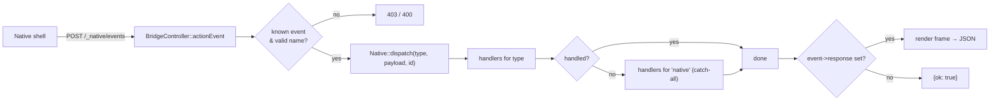
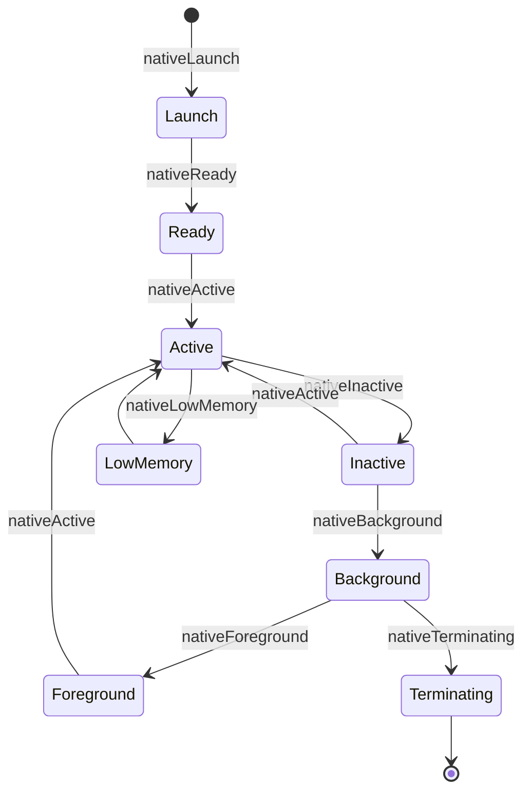
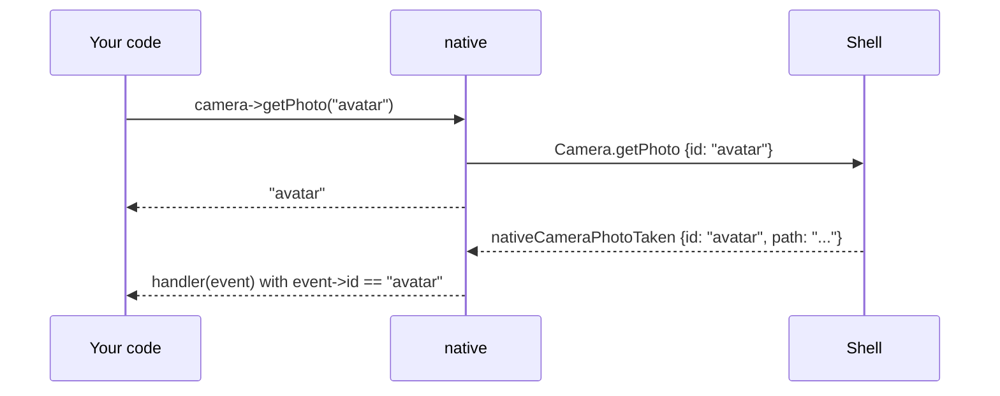

# Events

The native shell tells PHP what happened through **events**: lifecycle changes,
UI actions, and the completion of [interactive calls](device-apis.md#immediate-vs-interactive).

Events use Yii's normal event system on the `native` component, and carry a
`NativeEvent`:

```php
use greenmeteor\native\events\{NativeEvent, NativeEvents};

Yii::$app->native->on(NativeEvents::FOREGROUND, function (NativeEvent $e) {
    // app returned to the foreground
});
```

## `NativeEvent`

| Member | Meaning |
|---|---|
| `type` | Native event name, e.g. `nativeScannerScanned`. Prefer this over `$event->name`: Yii rewrites `name` for the catch-all trigger. |
| `payload` | Array sent by the shell |
| `get($key, $default)` | Read one payload value |
| `id` | Request id correlating the event with an interactive call (taken from `payload['id']` if not given separately) |
| `response` | Set a Widget / Element (or array) to reply with a UI frame over HTTP |
| `handled` | Set `true` to stop later handlers, including the catch-all |

## Dispatch flow



PHP can also dispatch events itself (e.g. from tests or an in-process shell):

```php
Yii::$app->native->dispatch(NativeEvents::DEEP_LINK, ['url' => 'acme://orders/42']);
```

## Lifecycle events



`NativeEvents::LAUNCH`, `READY`, `ACTIVE`, `INACTIVE`, `FOREGROUND`, `BACKGROUND`,
`TERMINATING`, `LOW_MEMORY`. The exact order is decided by the shell; treat the
diagram as the typical path, not a guarantee.

## App events

| Constant | Payload |
|---|---|
| `ACTION` | `action`, `id`, `value`, `payload`: a button/input/toggle was used |
| `DEEP_LINK` | `url` |
| `NETWORK_CHANGED` | `connected`, `type`, `isExpensive` |
| `PUSH_RECEIVED` | `title`, `body`, `data` |
| `NOTIFICATION_TAPPED` | `id`, `data` |

The complete list, with payloads, is in the [protocol reference](reference/protocol.md#events).

## Correlating results with requests

Interactive calls return an id; the completion event carries it back:



Always check `$event->id`: several features can be in flight at once, and some
(e.g. `PUSH_RECEIVED`) are not tied to a request at all.

## Where to register handlers

Because the runtime is meant to stay resident, register handlers **once**:

**1. In the component configuration** (recommended):

```php
'native' => [
    'class' => Native::class,
    'appId' => 'com.acme.shop',
    'on nativeCameraPhotoTaken' => [\app\native\PhotoHandler::class, 'handle'],
    'on native' => [\app\native\AuditLog::class, 'record'],     // catch-all
],
```

**2. In a bootstrap class** listed in your application's `bootstrap` array:

```php
class NativeBootstrap implements \yii\base\BootstrapInterface
{
    public function bootstrap($app)
    {
        $app->native->on(NativeEvents::DEEP_LINK, [DeepLinks::class, 'open']);
    }
}
```

Avoid registering handlers inside controller actions.

## Replying with a new screen

A handler for an event delivered over HTTP can answer with the next UI frame:

```php
Yii::$app->native->on(NativeEvents::ACTION, function (NativeEvent $e) {
    if ($e->get('action') === 'checkout') {
        $e->response = VStack::make([], [Text::make(['text' => 'Thanks!'])]);
    }
});
```

The endpoint returns `{"ok": true, "result": {"version": 1, "root": {...}}}`.
See [UI widgets](ui-widgets.md#the-action-loop).

## Event names from plugins

Plugins can declare their own events in the manifest (`events`); they are added
to the protocol at boot, so they are accepted by the HTTP events endpoint.
Anything else is rejected unless `http.allowUnknownEvents` is set. See
[Plugins](plugins.md).
