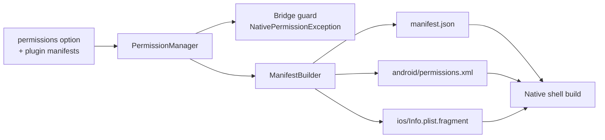

# Permissions & manifest

Mobile platforms require apps to **declare** what they use. Declare permissions
once in the component config; Yii2 Native

1. refuses calls that need an undeclared permission (clear PHP error), and
2. generates the Android and iOS manifest entries for the shell build.



## Declaring permissions

```php
'permissions' => [
    'camera' => 'Scan receipts and barcodes.',   // value = iOS usage description (optional)
    'location',                                  // no value: a default description is used
],
```

| Permission | Needed by | Android | iOS Info.plist |
|---|---|---|---|
| `camera` | `Camera.getPhoto`, `Camera.recordVideo`, `Scanner.scan` | `CAMERA` | `NSCameraUsageDescription` |
| `microphone` | `Microphone.start`, `Camera.recordVideo` | `RECORD_AUDIO` | `NSMicrophoneUsageDescription` |
| `location` | `Geolocation.getCurrentPosition` | `ACCESS_FINE_LOCATION`, `ACCESS_COARSE_LOCATION` | `NSLocationWhenInUseUsageDescription` |
| `background_location` | (plugins) | `ACCESS_BACKGROUND_LOCATION` | `NSLocationAlwaysAndWhenInUseUsageDescription` |
| `biometrics` | `Biometrics.prompt` | `USE_BIOMETRIC` | `NSFaceIDUsageDescription` |
| `photo_library` | `Camera.pickImages`, `Filesystem.saveToPhotos` | `READ_MEDIA_IMAGES`, `READ_MEDIA_VIDEO` | `NSPhotoLibraryUsageDescription`, `NSPhotoLibraryAddUsageDescription` |
| `push_notifications` | `Notifications.schedule`, `Notifications.enrollPush` | `POST_NOTIFICATIONS` | entitlement `aps-environment` |

Android also always receives `INTERNET`, `ACCESS_NETWORK_STATE` and `VIBRATE`.
Unknown permission names are reported by `validate()` / `native/doctor`.

Which functions need which permission is declared in `protocol.json`; the
[reference](reference/protocol.md) lists it per function.

Set `'enforcePermissions' => false` to turn off the PHP-side guard (the platform
still enforces its own).

## The generated manifest

```bash
php yii native/manifest            # print JSON
php yii native/manifest --write    # write into native/build/
php yii native/build               # validate, then write (see Console commands)
```

Files written to `native/build/`:

| File | Contents |
|---|---|
| `manifest.json` | App identity, deep links, permissions, platform entries, plugins, bridge function list |
| `android/permissions.xml` | `<uses-permission>` lines for `AndroidManifest.xml` |
| `ios/Info.plist.fragment` | `<key>` / `<string>` pairs to merge into `Info.plist` |

`manifest.json`:

```json
{
  "schema": 1,
  "generator": "greenmeteor/yii2-native 0.2.0",
  "protocolVersion": 1,
  "app": {"id": "com.acme.shop", "name": "Acme Shop", "version": "1.4.0", "versionCode": 14, "orientation": "portrait"},
  "deepLinks": {"scheme": "acme", "hosts": ["shop.acme.test"]},
  "permissions": ["camera", "location"],
  "android": {"permissions": ["android.permission.ACCESS_COARSE_LOCATION", "..."]},
  "ios": {"infoPlist": {"NSCameraUsageDescription": "Scan receipts."}, "entitlements": {}},
  "plugins": {},
  "bridgeFunctions": ["Biometrics.isAvailable", "..."]
}
```

Output is sorted and deterministic, so it diffs cleanly in version control.
Values written into XML fragments are escaped. The shells are expected to consume
`manifest.json`; `protocolVersion` lets a shell refuse an incompatible package.
