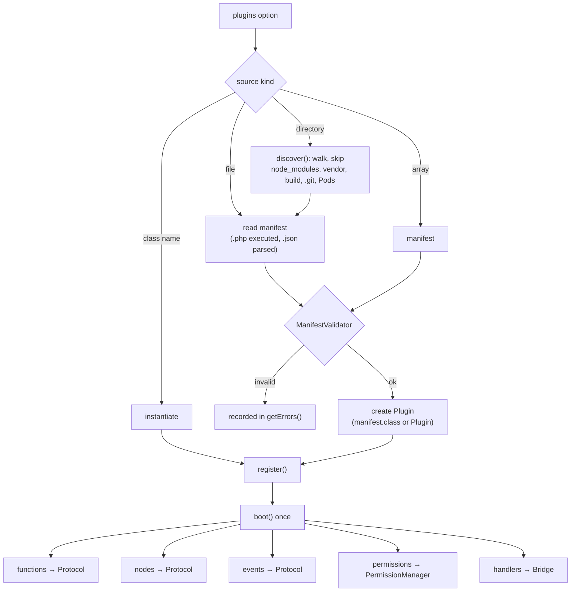

# Plugins

A plugin extends Yii2 Native with new **bridge functions**, **UI node types**,
**events** and **permissions**, plus the native (Swift / Kotlin) code that
implements them.

A plugin may provide:

- PHP-side bridge functions (handlers)
- declarations of native-side bridge functions, events and UI elements
- permissions it needs
- iOS Swift and Android Kotlin sources and dependencies

## Create one

```bash
php yii native/plugin/make acme/maps
```

creates `native/plugins/maps/`:

```text
native-plugin.php     # manifest
MapsPlugin.php        # PHP side (handlers)
README.md
ios/   android/       # native sources
```

## The manifest

`native-plugin.php` returns an array (or use `native-plugin.json`, which is
data-only and never executed):

```php
return [
    'id' => 'acme/maps',                   // required: name or vendor/name, lowercase
    'name' => 'Maps',
    'version' => '1.0.0',
    'description' => 'Embedded maps.',
    'class' => \acme\maps\MapsPlugin::class,   // optional: your Plugin subclass
    'platforms' => ['ios', 'android'],
    'permissions' => ['location'],
    'bridge' => [
        'functions' => [
            'Maps.open' => [
                'description' => 'Open the map at a location.',
                'interactive' => false,
                'permissions' => ['location'],
                'params' => [
                    'lat' => ['type' => 'number', 'required' => true],
                    'lng' => ['type' => 'number', 'required' => true],
                    'zoom' => ['type' => 'integer'],
                ],
            ],
        ],
    ],
    'elements' => ['map' => ['description' => 'Map view', 'properties' => ['lat', 'lng']]],
    'events' => ['mapsMarkerTapped' => ['description' => 'A marker was tapped']],
    'ios' => ['sources' => 'ios', 'dependencies' => ['MapKit']],
    'android' => ['sources' => 'android', 'dependencies' => ['com.google.android.gms:play-services-maps:18.2.0']],
];
```

| Key | Effect at boot |
|---|---|
| `bridge.functions` | added to the protocol: callable through the bridge (and HTTP, subject to `http.allow` / `deny`) |
| `elements` | new node types, accepted by the strict renderer |
| `events` | accepted by the HTTP events endpoint |
| `permissions` | merged into the app's permissions (and the generated manifests) |
| `ios`, `android`, `platforms` | consumed by the shell build via `manifest.json` |

> **`params` opts in to validation.** Functions that declare `params` get the
> same [argument validation](bridge.md#argument-validation) as built-ins. Functions
> without it are not validated.

The manifest is checked by `ManifestValidator` (id format, version, platforms,
known permissions, function naming `Namespace.method`, element and event names).
An invalid manifest is reported by `native/doctor` and not loaded.

## The PHP side

Extend `Plugin` and return handlers:

```php
class MapsPlugin extends \greenmeteor\native\plugin\Plugin
{
    public function handlers(): array
    {
        return [
            'Maps.geocode' => fn (array $args) => Geocoder::lookup($args['query']),
        ];
    }
}
```

Handlers run instead of the transport, even without a native runtime. Override
`boot(Native $native)` for custom wiring (call `parent::boot()` to keep the
manifest registration).

## Loading plugins

```php
'native' => [
    'class' => Native::class,
    'plugins' => [
        '@app/native/plugins',                  // a directory: every manifest below it
        '@app/native/plugins/maps/native-plugin.json',   // one manifest file
        \app\native\MyPlugin::class,            // a class implementing PluginInterface
        ['id' => 'inline', 'version' => '1.0.0'],        // an inline manifest array
    ],
],
```

Problems (bad manifest, missing path, boot error) are collected, not fatal:

```php
Yii::$app->native->pluginManager->getErrors();   // ['source' => 'message', ...]
```

`native/doctor` prints them.

## Discovery



### Composer packages

Publish a plugin as a Composer package with type `yii2-native-plugin`, or an
`extra.yii2-native` section:

```json
{
  "name": "acme/native-maps",
  "type": "yii2-native-plugin",
  "extra": { "yii2-native": { "manifest": "native-plugin.json" } }
}
```

`php yii native/plugin/discover` lists installed plugins (via
`vendor/composer/installed.json`) and those under `native/plugins/`; register
them in the `plugins` option. The manifest path must stay inside the package.

### Trust

Discovering a `native-plugin.php` **executes** it with `require`. Only point
discovery at code you trust (your project, vendor packages you installed). Prefer
`native-plugin.json` for third-party plugins.

## Lifecycle interfaces

| Interface | Purpose |
|---|---|
| `PluginInterface` | `getId()`, `getManifest()`: the minimum |
| `BootablePluginInterface` | `boot(Native $native)`: called once by `PluginManager::boot()` |

`Plugin` implements both.
