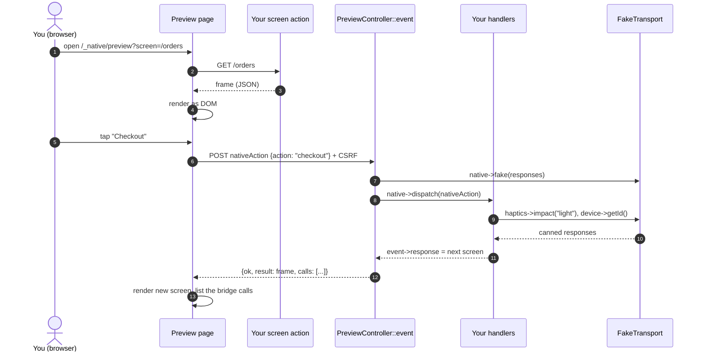

# Browser preview

A development tool for seeing a screen and trying its actions **without a
device or the native shell**. It draws the element tree as plain DOM, delivers
button taps, inputs and toggles to your PHP handlers, and shows which bridge
calls those handlers made.

> It approximates native rendering; it does not replicate it. Use it to check
> structure, copy, action wiring and handler behaviour, not pixel-level design.

## Enable it

Disabled by default. Every preview route returns 404 until you opt in:

```php
'native' => [
    'class' => Native::class,
    'appId' => 'com.acme.shop',
    'preview' => [
        'enabled' => YII_ENV_DEV,                       // never in production
        'fake' => true,                                 // default: device calls hit a fake transport
        'responses' => ['Device.getId' => 'preview-device'],   // canned answers for the fake
    ],
],
```

Then open `/_native/preview?screen=/orders` in a browser, where `/orders` is any
**same-origin** URL that returns a frame (an action using
[`asNative()`](ui-widgets.md#returning-a-screen-from-an-action)). The page also has
an input to load other screens.

## How it works



With `fake => true` (the default), your handlers run against an in-memory
transport, so `Camera`, `SecureStorage` and friends don't need a device. The
page lists each call (function and arguments) as it happens. Set
`'fake' => false` to run handlers against the real bridge rules; calls then throw
`NativeUnavailableException` unless a runtime is attached.

## What it supports

All 19 node types are drawn: text, button, image, icon, input, toggle, spacer,
divider, loading, fab, vstack, hstack, zstack, scroll, card, list, topbar,
bottomnav, navitem. Unknown node types appear as `[unsupported: type]` so
plugin elements are visible rather than silently dropped.

| Interaction | Event delivered |
|---|---|
| Button, nav item, FAB, top-bar action | `nativeAction` with `action`, `id`, `payload` |
| Input with `onChange` | `nativeAction` with `value` on every edit |
| Input with `action` | `nativeAction` with `value` on Enter |
| Toggle with `action` | `nativeAction` with `value` (`true` / `false`) |

Only `nativeAction` events can be sent from the preview; anything else is
rejected with 400.

## Safety

The preview is a development tool, and is built so that leaving it on by
accident is low-risk, but it should still never be enabled in production:

- **Off by default**; all routes 404 when disabled.
- `GET`/`POST` verbs enforced; events require Yii's **CSRF token**.
- The renderer uses `textContent` only: frame data is never interpreted as HTML.
  Image sources are restricted to `http(s)`, root-relative paths and `data:image/*`.
- The `screen` query parameter is embedded with `Json::htmlEncode`
  (a `</script>` payload cannot break out), and the page only fetches
  **same-origin** screens.
- `SecureStorage` call arguments are never echoed into the page, and the
  `http.secret` is never included in it.
- `native/doctor` reports the preview as a **failure** in a `YII_ENV_PROD`
  environment, and a warning anywhere else it is enabled.

## Standalone use of the renderer

`resources/preview/preview.js` exports `renderFrame(frame, container, {onAction})`
and `renderNode`, which work in any DOM, for example in your own documentation
or visual tests. They are covered by `tests/js/preview.test.mjs`.
