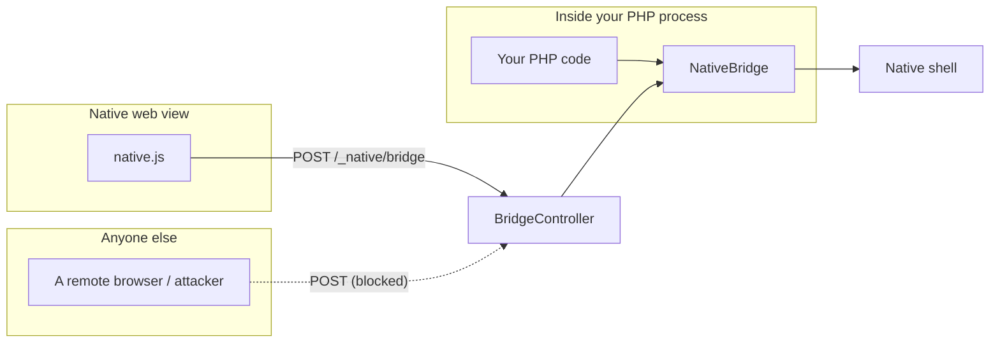
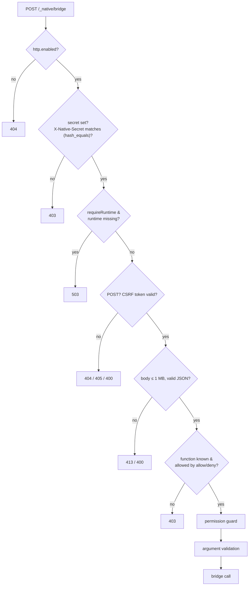

# Security

The native bridge lets code call device capabilities (camera, secure storage,
...). Yii2 Native therefore treats anything that can reach it as a trust
boundary.

## Two ways to reach the bridge



- **PHP code** calls the bridge directly. That's your own code, trusted as usual.
- **The web view** (or any HTTP client) reaches it through the HTTP endpoints,
  which exist so `native.js` works. Treat this path as untrusted input.

## Layers protecting the HTTP bridge



| Layer | What it stops |
|---|---|
| `enabled` | Exposing the endpoints at all if you don't need them |
| Shared `secret` | Requests that don't come from your shell (constant-time comparison) |
| `requireRuntime` (default on) | A normal browser hitting your *web* deployment of the same app |
| POST only + Yii CSRF validation | Cross-site request forgery |
| Body size cap (1 MB), strict JSON shape | Resource abuse / malformed input |
| Known functions only, `allow` / `deny` | Calling arbitrary names; narrowing the surface |
| Permission guard | Calling capabilities the app never declared |
| Argument validation | `javascript:` / `file:` URLs, wrong types, unknown keys, NUL-byte paths, oversized strings |
| Events: known names only | Spoofing arbitrary server-side events (`allowUnknownEvents` is off by default) |

### Recommended production settings

```php
'native' => [
    'class' => Native::class,
    'http' => [
        'secret' => getenv('NATIVE_SECRET'),           // 16+ chars, injected into the shell build
        'requireRuntime' => true,                      // default
        'allow' => ['Device.*', 'Haptics.*', 'Dialog.*', 'SecureStorage.*'],   // only what the web UI needs
        'deny' => ['Filesystem.*'],
    ],
],
```

If you only drive native features from PHP and never from JavaScript or UI
events over HTTP, set `'http' => ['enabled' => false]`. This also disables the
events endpoint, so UI actions then have to reach PHP through your own channel
(for example by calling `Native::dispatch()` from an in-process shell).

`php yii native/doctor` flags risky combinations; notably it **fails** when the
HTTP bridge is enabled with neither a secret nor `requireRuntime`.

## The preview

The [browser preview](preview.md) is a separate, **development-only** surface. It
is off by default (all routes return 404), accepts only `nativeAction` events,
requires the CSRF token, and `native/doctor` fails if it is enabled in a
`YII_ENV_PROD` environment. Do not enable it in production.

## Things the package does for you

- Function names are matched with `\z`-anchored patterns (PCRE `$` would accept
  a trailing newline).
- The bridge never logs call arguments.
- Browser / Share URL parameters accept only absolute `http(s)` URLs.
- Plugin manifests discovered through Composer must resolve **inside** the
  package directory.
- Build XML fragments escape permission descriptions.
- Deep links are accepted only for your own scheme and hosts, with traversal-style and control-character inputs rejected.

## Things that remain your responsibility

- **Plugin code is code.** A `native-plugin.php` is executed when discovered. Only
  load plugins you trust.
- **Build commands** under `build` run with `--exec` and are shell commands from
  your own config.
- **Events carry user-controlled data.** Treat `NativeEvent::$payload`
  (e.g. file paths from a picker, scanned text) as untrusted input; validate it
  before touching the filesystem or database.
- **Native-side checks.** PHP validation protects the PHP path; the shell should
  still enforce platform permissions, sandboxing and URL policy.
- **Secrets in the shell.** Anything compiled into the app can be extracted.
  The shared secret slows casual abuse; it is not a substitute for CSRF and
  runtime checks.

## Reporting

Please report vulnerabilities privately to the maintainers rather than in a
public issue.
