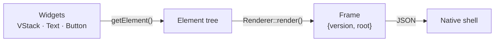
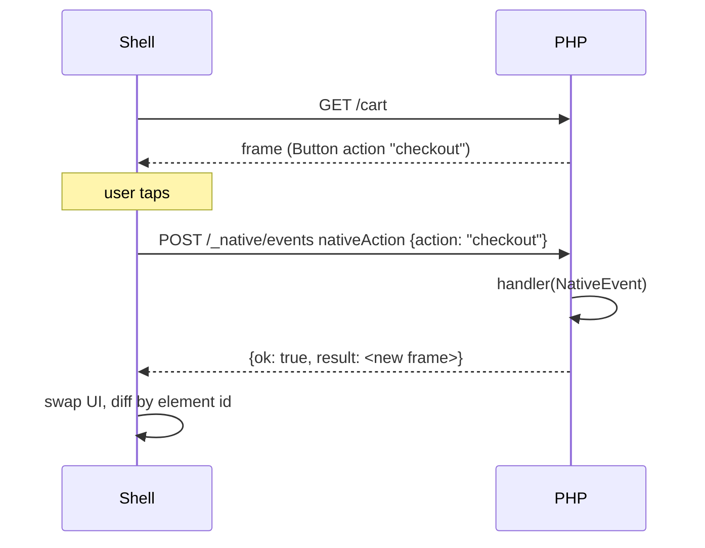

# UI widgets

Widgets describe native UI in PHP. They build a framework-neutral **element
tree**; the renderer turns it into a **frame** that the shell draws with SwiftUI
or Jetpack Compose.



## Composing a screen

Use `make()`, which returns widget **instances** that nest:

```php
use greenmeteor\native\widgets\{Button, Card, HStack, Icon, Text, VStack, ScrollView};

$screen = ScrollView::make([], [
    VStack::make(['spacing' => 12, 'padding' => 16], [
        Text::make(['text' => 'Orders', 'size' => 28, 'weight' => 'bold']),
        array_map(fn ($o) => Card::make(['elevation' => 2], [
            HStack::make(['spacing' => 8, 'align' => 'center'], [
                Icon::make(['name' => 'package']),
                Text::make(['text' => "#{$o->id}"]),
            ]),
        ]), $orders),                      // lists are flattened
        $canCreate ? Button::make(['text' => 'New order', 'action' => 'order.new']) : null,   // null is skipped
    ]),
]);
```

`make(array $config = [], array $children = [])`: children may be widgets,
`Element`s, `null`/`false` (ignored) or nested lists of those. You can also use
`$widget->add(...)` / `->child($c)` or the `children` config key.

> **Why not `Text::widget([...])`?** Yii's static `widget()` returns the
> *rendered output*. For native widgets that's a JSON string for that single
> widget, which can't be used as a child of another widget. Use `make()` for
> composition. (`widget()` still works for rendering a standalone widget.)

## Returning a screen from an action

```php
use greenmeteor\native\web\RendersNative;

class OrdersController extends \yii\web\Controller
{
    use RendersNative;

    public function actionIndex()
    {
        return $this->asNative($this->buildScreen());
    }
}
```

`asNative()` sets the response format to `native` (registered by the bootstrap),
which encodes the frame as JSON. Or render directly:

```php
$frame = Yii::$app->native->renderer->render($screen);                    // array
$json  = Yii::$app->native->renderer->encode($screen);                    // string
$frame = Yii::$app->native->renderer->render($screen, ['title' => 'Home']); // + meta
```

A frame looks like:

```json
{
  "version": 1,
  "root": {
    "type": "vstack",
    "properties": {"spacing": 12, "id": "root"},
    "children": [
      {"type": "text", "properties": {"text": "Orders", "id": "root.0"}, "children": []}
    ]
  }
}
```

## Ids

Elements without an explicit id get a **deterministic, path-based id**
(`root`, `root.0`, `root.1.2`, ...) so the shell can diff consecutive frames.
Give an element an explicit `id` when its position may change (list items,
elements you want to find later):

```php
Text::make(['id' => 'total', 'text' => '42']);
$screen->getElement()->find('total');
```

Disable generation with `'assignIds' => false` on the renderer.

## Widgets

Every widget also accepts the **common properties**:

| Property | Type | Notes |
|---|---|---|
| `padding`, `margin` | number, `[vertical, horizontal]` or `[top, right, bottom, left]` | |
| `background` | string | colour |
| `width`, `height` | number or `"fill"` | |
| `visible` | bool | |
| `accessibilityLabel`, `testId` | string | |
| `properties` | array | raw protocol properties; override computed ones |

Properties that are `null` are not sent.

| Widget | Node | Container | Key properties |
|---|---|---|---|
| `Text` | `text` | no | `text`, `size`, `weight`, `color`, `align`, `maxLines` |
| `Button` | `button` | no | `text`, `action`, `payload`, `variant`, `disabled`, `icon` |
| `Image` | `image` | no | `source`, `alt`, `contentMode`, `cornerRadius` |
| `Icon` | `icon` | no | `name`, `size`, `color` |
| `TextInput` | `input` | no | `name`, `value`, `placeholder`, `keyboard`, `secure`, `multiline`, `action`, `onChange` |
| `Toggle` | `toggle` | no | `name`, `label`, `value`, `action` |
| `Spacer` | `spacer` | no | `size` (omit for flexible space) |
| `Divider` | `divider` | no | `thickness`, `color` |
| `Loading` | `loading` | no | `size`, `message` |
| `Fab` | `fab` | no | `icon`, `action`, `label` |
| `VStack` / `HStack` | `vstack` / `hstack` | yes | `spacing`, `align`, `justify` |
| `ZStack` | `zstack` | yes | `align` |
| `ScrollView` | `scroll` | yes | `horizontal`, `showsIndicator` |
| `Card` | `card` | yes | `elevation`, `cornerRadius` |
| `LazyList` | `list` | yes | `itemSpacing`: virtualised list |
| `TopBar` | `topbar` | yes | `title`, `subtitle`, `showBack`, `actions` |
| `BottomNav` | `bottomnav` | yes | `activeId`; children are `BottomNavItem` |
| `BottomNavItem` | `navitem` | no | `label`, `icon`, `action`, `active`, `badge` |

A typical app shell:

```php
ZStack::make([], [
    TopBar::make(['title' => 'Shop', 'actions' => [['icon' => 'search', 'action' => 'search']]]),
    LazyList::make(['itemSpacing' => 8], $rows),
    BottomNav::make(['activeId' => 'home'], [
        BottomNavItem::make(['id' => 'home', 'label' => 'Home', 'icon' => 'home', 'action' => 'nav.home', 'active' => true]),
        BottomNavItem::make(['id' => 'cart', 'label' => 'Cart', 'icon' => 'cart', 'action' => 'nav.cart', 'badge' => '3']),
    ]),
    Fab::make(['icon' => 'add', 'action' => 'compose']),
]);
```

## The action loop

Buttons, inputs, toggles, top-bar actions and nav items emit a `nativeAction`
event with the `action` name (plus `id`, `value` and any `payload`). Handle it in
PHP and optionally answer with the next screen:



```php
Yii::$app->native->on(NativeEvents::ACTION, function (NativeEvent $e) {
    match ($e->get('action')) {
        'checkout' => $e->response = CheckoutScreen::build(),
        'search'   => $e->response = SearchScreen::build(),
        default    => null,
    };
});
```

## Validation

Widgets fail early:

- children must be widgets or elements (`InvalidArgumentException` otherwise, naming the type given);
- `TopBar` actions must have an `action` name.

For development, enable strict rendering so unknown node types throw:

```php
'rendererClass' => ['class' => Renderer::class, 'strict' => YII_DEBUG],
```

or check without throwing: `$renderer->validate($tree)` returns a list of problems.

## Custom elements

A [plugin](plugins.md) can declare new node types (`elements` in its manifest);
subclass `Widget` to use them from PHP:

```php
class MapView extends \greenmeteor\native\widgets\Widget
{
    public float $lat = 0.0;
    public float $lng = 0.0;

    public function getElementType(): string { return 'map'; }

    protected function elementProperties(): array
    {
        return ['lat' => $this->lat, 'lng' => $this->lng];
    }
}
```
